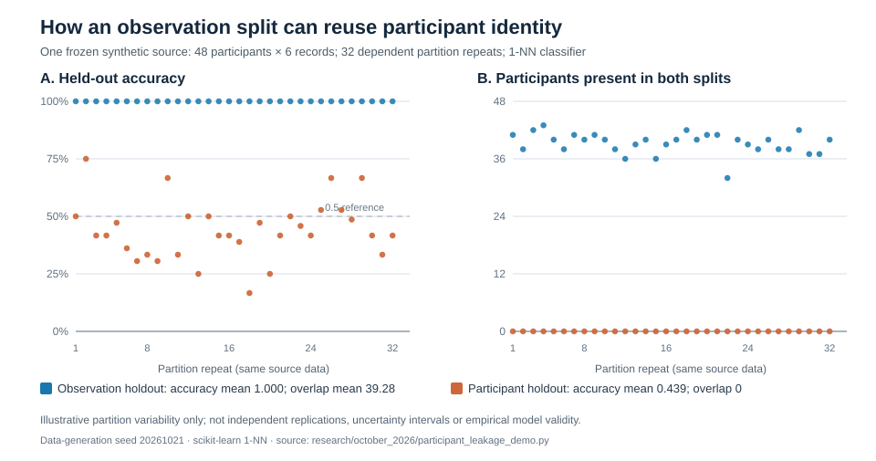

# Participant identity leakage: a synthetic split-level falsification

**Research-only methods article · 21 October 2026 · gp3mlpy scientific website**

> **Scope.** This article explains why a held-out *observation* is not necessarily a held-out *participant*. The reproducible experiment uses deliberately synthetic, repeated records and does not estimate a real-world model's performance. The demonstration script is available in the GitHub source tree, **not** the installed `gp3mlpy==0.1.1` public API.

## Question and target

If the intended use is prediction for **previously unseen participants**, does randomly holding out individual records estimate that target? Not when distinct records from the same participant occur in both fitting and assessment partitions. Participant-specific measurements can serve as an identity key, allowing the model to retrieve labels without learning a transportable outcome relation.

Let `g(i)` identify the participant of row `i`, and let `T` and `V` denote train and validation row sets. A necessary non-overlap condition for new-participant assessment is

```text
{g(i): i in T} ∩ {g(i): i in V} = ∅.
```

This necessary condition is not sufficient to establish external validity, and even participant-disjoint splits do not preclude stimulus, site, time, preprocessing, selection, or label leakage.

## Prospectively reproducible illustration

The **single frozen synthetic source** contains 48 participants, six records per participant, eight Gaussian fingerprint features, and a balanced random binary participant label. The label is independently randomized across participants and copied to their six records. Each record is its participant's fingerprint plus small independent noise (SD 0.03). No signal capable of generalizing the randomized label to *new participants* was built into the data.

We evaluate the same one-nearest-neighbor (`k = 1`) classifier under two different validation operations:

1. **Observation holdout:** stratified random split of rows, 25% test rows. Many participants are seen in both partitions.
2. **Participant holdout:** group-disjoint random 25% participant split using `GroupShuffleSplit`. No participant can occur in both partitions.

Both operations are repeated with seeds `20261021 + r` for `r = 0, ..., 31`, using the same original synthetic features and labels in every repeat. The resulting 64 evaluations are **dependent partitions of one dataset**, not 64 independent generated experiments. The estimator is fixed; there is no tuning, outcome-driven selection, or uncertainty interval.

## Results: partition definition changes the scientific claim



*Figure 1.* Original numerical plot generated from the frozen synthetic source. Both panels display the 32 repeat-level values rather than an artificial confidence band. The horizontal 0.5 line is an orientation reference for a balanced random binary outcome, not a measured calibration guarantee.

| Descriptive result across 32 dependent partitions | Observation holdout | Participant holdout |
|---|---:|---:|
| Mean test accuracy | **1.0000** | **0.4392** |
| Accuracy range | 1.0000–1.0000 | 0.1667–0.7500 |
| Mean distinct participants shared by train and test | **39.28** | **0** |
| New-participant deployment claim evaluated? | **No** | **Yes, on this one synthetic source** |

The observation split permits one-nearest-neighbor identification of participants already represented in the training set, so its perfect record-level score does **not** demonstrate new-participant prediction. Participant-disjoint evaluation removes this direct identity route; its descriptive accuracy varies substantially with which participants enter the test partition.

The contrast is an **existence demonstration of estimand mismatch**, not a calibrated effect size for eye-tracking, physiology, or machine-learning datasets. The participant-split mean below 0.5 is a finite-sample, partition-dependent realization and does not demonstrate systematic underperformance.

## Reproduce and audit

Check out the repository source and install its pinned or compatible development dependencies. From its root run:

```bash
python research/october_2026/participant_leakage_demo.py
python -m pytest tests/test_october_2026_participant_leakage.py -q
```

The script writes `research/october_2026/split_audit.csv` locally. Every row records the strategy, repeat index, held-out accuracy, training and test participant counts, and the **exact shared-participant count**. The script does not modify the frozen installed `gp3mlpy` API.

[Browse reproducible source and regression tests on GitHub](https://github.com/stefanosbalaskas/gp3mlpy/tree/main/research/october_2026) (available on `main` only after the reviewed change is merged).

## What it does—and does not—establish

- **Establishes:** reproducible split-level evidence that testing on unseen observations can reuse participant identity, and a regression assertion that the designated participant-level test split contains zero shared participants.
- **Does not establish:** measured device validity, empirical out-of-participant transport, causal identifiability, optimized algorithms, sample-size adequacy, interval calibration, or superiority across real-world datasets.
- **Actionable rule:** define the independent deployment unit before preprocessing or partitioning; log shared participant, stimulus and site identities; tune and fit any transform inside training folds; report the exact held-out unit and repeat dependence.

For production workflows, start with [participant generalization](participant-generalization.md), [nested grouped resampling](nested-grouped-resampling.md), and [contaminated-manifest leakage](contaminated-manifest-leakage.md). This source-only illustration is a methodological companion, not a new public package feature.
